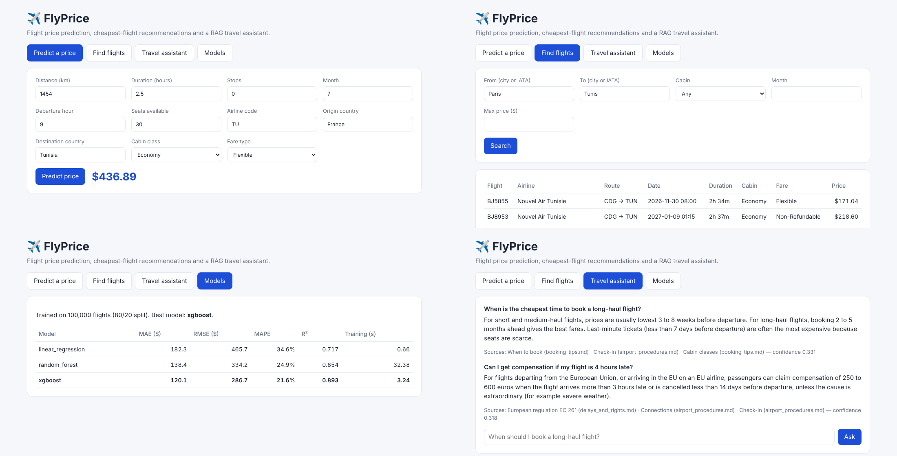

# FlyPrice — Flight price prediction, recommendations and RAG travel assistant

An end-to-end machine learning application:

- **Price prediction** — three regressors (Linear Regression, Random Forest, **XGBoost**) trained on 100,000 flights and compared with **MLflow**; the best one is served by a **FastAPI** backend.
- **Recommendations** — cheapest flights between two cities or airports, with cabin, month and budget filters; popular routes and airline statistics.
- **Travel assistant (RAG)** — questions about booking, baggage, airports, visas and passenger rights are answered from a small knowledge base indexed in **FAISS**; an LLM (Groq) writes the answer when an API key is set.
- **React + TypeScript** front end, **Docker Compose** deployment, **pytest** tests and **GitHub Actions** CI.



## Results

Test set: 20,000 flights (random 80/20 split of 100,000). Models learn `log1p(price)`; errors are reported in USD.

| Model | MAE ($) | RMSE ($) | MAPE | R² | Training time |
| --- | --- | --- | --- | --- | --- |
| Linear Regression (one-hot) | 182.3 | 465.7 | 34.6% | 0.717 | 0.7 s |
| Random Forest | 138.4 | 334.2 | 24.9% | 0.854 | 32 s |
| **XGBoost** | **120.1** | **286.7** | **21.6%** | **0.893** | 3 s |

Prices in this dataset include a random seasonal factor, so part of the variance cannot be predicted; the remaining error is mostly that noise. Full numbers: [`results/metrics.json`](results/metrics.json).

## Architecture

```
code/dataset_extended.py ──► data/flights_dataset_100000.csv.xz ──► code/EDA.ipynb
                                         │
                         flyprice/train.py (LR · RF · XGBoost, MLflow) ──► models/best_model.joblib
                                         │
rag_knowledge/*.md ──► flyprice/rag.py (chunks → embeddings → FAISS) ─┐
                                         │                              │
                               flyprice/api.py (FastAPI) ◄──────────────┘
                                         │  REST (/api)
                               frontend/ (React + TypeScript, nginx)
```

| Path | Content |
| --- | --- |
| `code/dataset_extended.py` | generates the dataset from OpenFlights routes, airports and airlines (haversine distance, cabin class, region and season pricing) |
| `code/EDA.ipynb` | exploratory data analysis |
| `flyprice/features.py` | features used by training and the API |
| `flyprice/train.py` | training, comparison and MLflow tracking; saves the best model |
| `flyprice/recommend.py` | recommendations, popular routes, airline statistics |
| `flyprice/rag.py` | RAG assistant: section chunking, embeddings, FAISS search, optional LLM generation |
| `flyprice/api.py` | FastAPI application |
| `frontend/` | React + TypeScript interface |
| `tests/` | API tests (a small model is trained on `data/sample_flights_3000.csv`) |

### Features

Numeric: distance, duration, stops, departure hour, month, seats available.
Categorical: airline code, origin country, destination country, cabin class, fare type, flight category.
Tree models use ordinal encoding; the linear baseline uses standardisation + one-hot encoding.

### RAG assistant

The Markdown files in `rag_knowledge/` are split into one chunk per section and embedded with **Sentence Transformers** (`all-MiniLM-L6-v2`) when available, or a **TF-IDF** fallback (words + character n-grams) that works offline. Vectors are L2-normalised and searched in a FAISS inner-product index (cosine similarity). Questions below a similarity threshold are answered "I don't know" instead of guessing. With `GROQ_API_KEY` set, the retrieved passages are sent to an LLM that must answer only from them; otherwise the best passage is returned with its sources and a confidence score.

## API

| Method | Route | Role |
| --- | --- | --- |
| GET | `/health` | server status |
| POST | `/predict/single` | price of one flight |
| POST | `/predict` | batch prediction |
| GET | `/predict/model/info` | best model and metrics of all models |
| GET | `/predict/sample-flights` | random flights from the dataset |
| GET | `/recommend?origin=Paris&destination=Tunis` | cheapest matching flights (filters: `cabin_class`, `month`, `max_price`) |
| GET | `/recommend/popular-routes` | most frequent routes |
| GET | `/recommend/airline-stats` | flights and average price per airline |
| POST | `/chat` | question to the travel assistant |
| GET | `/chat/knowledge/search?q=...` | raw retrieval results |
| GET | `/chat/knowledge/categories` | knowledge base topics |

Interactive documentation: http://localhost:8000/docs

```bash
curl -X POST localhost:8000/predict/single -H "Content-Type: application/json" -d '{
  "distance_km": 1454, "duration_hours": 2.5, "stops": 0, "departure_hour": 9, "month": 7,
  "seats_available": 30, "airline_code": "TU", "origin_country": "France", "dest_country": "Tunisia",
  "cabin_class": "Economy", "fare_type": "Flexible", "flight_category": "Moyen-courrier (500-2000 km)"}'
```

## Run it

### Docker

```bash
docker compose up --build
# Frontend http://localhost:3000 · API http://localhost:8000/docs · MLflow http://localhost:5000
```

### Locally

```bash
python -m venv .venv && source .venv/bin/activate      # Windows: .venv\Scripts\activate
pip install -r requirements-dev.txt

python -m flyprice.train            # trains the 3 models (~1 min), logs to MLflow, saves models/best_model.joblib
mlflow ui --backend-store-uri sqlite:///mlflow.db     # compare runs at http://localhost:5000
uvicorn flyprice.api:app --reload   # API at http://localhost:8000
pytest -q

cd frontend && npm install && npm run dev               # UI at http://localhost:5173
```

Optional: `export GROQ_API_KEY=...` to let an LLM write the assistant's answers.
To regenerate the dataset (needs internet for OpenFlights): `python code/dataset_extended.py`, then `xz -9 flights_dataset_100000.csv` and move it to `data/`.

## Data

The flights are **synthetic**: real routes, airports and airlines from [OpenFlights](https://openflights.org/data), with prices generated from distance, cabin class, region and season. Do not use the predictions for real bookings.

## Credits

This project started as a team academic project at TEK-UP University (Roua Tabarki, Saif Sbaiti, Yossri Karchoud, Ayette Mansouri), which produced the dataset generator. This repository is the complete implementation of the application by **Saif Sbaiti** — [LinkedIn](https://www.linkedin.com/in/saif-sbaiti-3b9a32360).
